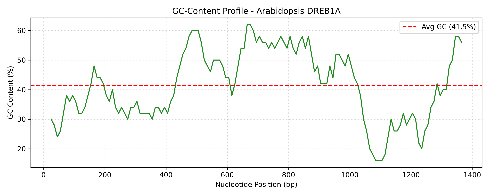

# Plant Abiotic Stress Gene Profiler (DREB1A)
This is an automated computational biology pipeline built in Python to retrieve, parse, and analyze dehydration-responsive transcription factors (DREB/CBF family) from NCBI GenBank.

## Overview
Nowadays, drought and salinity are major abiotic stresses which limits global crop yields. This issue causes hunger and malnutrition in certain parts of the world. This tool programmatically inspects stress-signaling genes in model plants (Arabidopsis thaliana) to map regulatory motifs, translate coding sequences, and compute GC-content profiles.

## Pipeline Features
- NCBI Entrez Integration: Automated querying and parsing of GenBank records.
- CDS Extraction & Translation: Identifies coding regions and generates peptide sequences.
- Motif Detection: Scans for the core Dehydration-Responsive Element (`GCCGAC` / `ACCGAC`).
- GC-Content Analysis: Calculates sliding-window GC distributions (Window: 50 bp, Step: 10 bp).

## Results: Arabidopsis thaliana DREB1A


- Accession: NM_118680
- Mean GC Content: 41.5%
-Key Observation: There is a marked elevation in GC content (~55–60%) across positions 450–950 bp, which aligns directly with the functional coding sequence (CDS).

## Setup & Usage
```bash
git clone [https://github.com/](https://github.com/)<your-username>/plant-dreb-gene-profiler.git
cd plant-dreb-gene-profiler
pip install -r requirements.txt
python profiler.py
